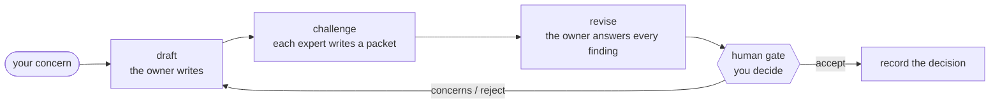
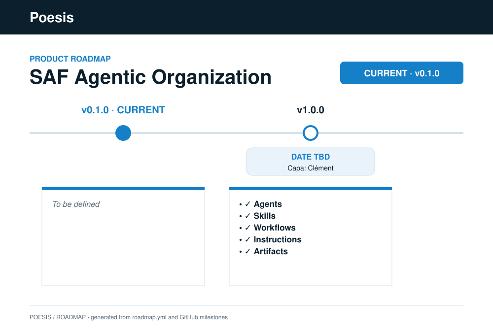

# SAF Agentic Organization

[](https://github.com/poesis-cloud/saf-agentic-organization/actions/workflows/ci.yml)
[](https://github.com/poesis-cloud/saf-agentic-organization/releases/latest)
[](LICENSE)

> **Full SAFe® as an agentic organization** for GitHub Copilot / VS Code and portable agent hosts.
> Four orchestrators (Portfolio, Large Solution, ART, Team), the SAFe roles that author each
> artifact, and a bench of experts with real IT jobs who challenge every main artifact before a
> human decides. Open-source developer tooling from [Poesis Cloud](https://poesis.cloud).

---

## The SAF solution

This repository is one of the three products of the Systemic Agentic Framework (SAF):

| Product | Repository | Role |
|---|---|---|
| Agentic Harness | [`saf-agentic-harness`](https://github.com/poesis-cloud/saf-agentic-harness) | the deterministic execution engine, methodology- and host-agnostic |
| **SAF Agentic Organization** | **this repository** | the SAFe framework application the harness executes |
| Agentic Workspace | [`saf-agentic-workspace`](https://github.com/poesis-cloud/saf-agentic-workspace) | the shared data plane the harness checks and commits into |

The harness resolves this framework through `FRAMEWORK_DIR` and the workspace through
`FRAMEWORK_WORKSPACE_DIR`: the three products stay decoupled through environment-anchored paths.

## How it works

You state a concern to the orchestrator of your layer. It maps the concern to one workflow, and
the workflow brings you one challenged artifact to decide on:



- **One step, one agent, one artifact.** The harness resolves every step, authorizes and
  validates every write, and accepts a step only if it delivered its artifact.
- **Experts challenge, owners answer, humans decide.** An expert never edits the artifact it
  challenges; the owner must accept, reject or defer every finding; nothing is approved without
  your decision, and the harness refuses an acceptance that no expert challenged.
- **Small contexts.** A worker gets three short instructions, one craft skill and one template.

Start with the [usage model](docs/usage-model.md). The full roster, workflow catalog, challenge
panels and artifact kinds are in the [catalog](docs/catalog.md); how SAFe maps onto all of it,
and what was verified against the SAFe knowledge base, is in
[SAFe conformance](docs/safe-conformance.md).

## The organization at a glance

**38 agents, 61 workflows, 34 artifact kinds, across the four layers of Full SAFe.**

| Layer | Orchestrator you talk to | SAFe roles that author | What reaches your gate |
|---|---|---|---|
| Portfolio | `value-management-officer` | `portfolio-manager`, `epic-owner`, `enterprise-architect`, `business-owner` | Strategic Themes, Portfolio Vision, value streams, Epics and enabler Epics, Lean Business Cases, Lean Budgets, Portfolio Roadmap, Architecture Vision |
| Large Solution | `solution-train-engineer` | `solution-manager`, `solution-architect` | Solution Train canvas, Solution Vision, Solution Intent, Capabilities and enabler Capabilities, Solution Roadmap, supplier agreements, Solution Train PI Objectives |
| ART | `release-train-engineer` | `product-manager`, `system-architect` | ART canvas, Product Vision, PI Roadmap, Features and enabler Features, architecture decisions, NFRs, delivery pipeline, PI Objectives, releases |
| Team | `scrum-master` | `product-owner` | Team charter, Stories, iteration plans, code changes |

**The expert bench (25 real IT jobs).** Each sits on the panels where its lens matters:

| Family | Experts |
|---|---|
| Engineering | `software-engineer`, `quality-engineer`, `devops-engineer`, `platform-engineer`, `database-administrator`, `data-engineer`, `ai-engineer`, `systems-engineer` |
| Operations | `site-reliability-engineer`, `observability-engineer`, `release-manager` |
| Security, privacy, compliance, legal | `security-expert`, `data-protection-officer`, `compliance-officer`, `legal-counsel` |
| Finance and sourcing | `financial-controller`, `finops-engineer`, `procurement-manager` |
| Product, design and content | `ux-designer`, `accessibility-specialist`, `product-marketing-manager`, `technical-writer` |
| Business and practice | `business-analyst`, `data-analyst`, `agile-coach` |

For example, a Feature is drafted by the Product Manager and challenged by the System Architect,
Software Engineer, Quality Engineer, Security Expert, UX Designer and Data Protection Officer; a
release is drafted by the Release Manager and challenged by the Site Reliability Engineer,
Observability Engineer, Security Expert, Quality Engineer and Technical Writer.

## Installing

The organization ships as the Copilot plugin `poesis-saf-agentic-organization`. It needs the
harness plugin `poesis-saf-agentic-harness`; both come from the marketplace
[`poesis-cloud/saf-marketplace`](https://github.com/poesis-cloud/saf-marketplace), as `poesis-saf`
(stable, branch `main`) or `poesis-saf-preview` (pre-releases, branch `preview`).
Requirements: the [Copilot CLI](https://docs.github.com/copilot/how-tos/set-up/install-copilot-cli),
Git ≥ 2.38 with a Git identity, and Python ≥ 3.10.

**One command** (Copilot CLI, also used by the GitHub Copilot app). It adds the marketplace if it
is missing and installs both plugins; add `--preview` / `-Preview` for the pre-release channel:

```bash
curl -fsSL https://raw.githubusercontent.com/poesis-cloud/saf-agentic-organization/main/install.sh | sh
```

```powershell
irm https://raw.githubusercontent.com/poesis-cloud/saf-agentic-organization/main/install.ps1 | iex
```

**Manually** with the Copilot CLI (for preview, add `poesis-cloud/saf-marketplace#preview` and
install `@poesis-saf-preview`):

```bash
copilot plugin marketplace add poesis-cloud/saf-marketplace
copilot plugin install poesis-saf-agentic-harness@poesis-saf
copilot plugin install poesis-saf-agentic-organization@poesis-saf
```

**GitHub Copilot app:** Customize → marketplaces → add `poesis-cloud/saf-marketplace`, then
install both plugins. **VS Code:** enable `chat.plugins.enabled`, add the marketplace to
`chat.plugins.marketplaces`, install both plugins, and use Session Target: Copilot.

**From a checkout** (contributors): `make plugin PLUGIN_DIR=<dir>` renders the plugin, then
`copilot plugin install <dir>` installs it.

## Initialising a workspace

The harness governs only a **SAF workspace**: a Git repository whose `HEAD` holds
`.saf/workspace.yaml`. Open the repository in a trusted folder (in an untrusted folder the
harness hooks do not run), start a Copilot session, and ask to initialise it as a SAF workspace.
The `init` skill checks Git, writes and commits
`.saf/workspace.yaml` and `.github/copilot/settings.json` (which recommends the marketplace and
enables both plugins for everyone who opens the repository). Then start a new Copilot session and
pick the orchestrator of your layer: `value-management-officer`, `solution-train-engineer`,
`release-train-engineer` or `scrum-master`
(`copilot --agent poesis-saf-agentic-organization:<orchestrator>`). One orchestrator session
drives one workflow run; the orchestrator names the next workflow at each gate. Host details
are in [docs/hosts/copilot-plugin.md](docs/hosts/copilot-plugin.md).

**Claude Code.** The organization also renders as a Claude Code plugin
(`make plugin-claude CLAUDE_PLUGIN_DIR=<dir>`), used beside the harness's Claude Code plugin
(`make plugin-claude` in `saf-agentic-harness`). Both are published in the same marketplace,
`poesis-cloud/saf-marketplace` (`claude plugin marketplace add poesis-cloud/saf-marketplace`, then
`claude plugin install <plugin>@poesis-saf`); from a checkout, load them with `claude --plugin-dir
<harness plugin> --plugin-dir <organization plugin> --agent
poesis-saf-agentic-organization:<orchestrator>` from a SAF workspace. Details are in
[docs/hosts/claude-plugin.md](docs/hosts/claude-plugin.md).

## Deterministic harness

The [`saf-agentic-harness`](https://github.com/poesis-cloud/saf-agentic-harness) plugin's hooks
resolve each workflow step, its model, instructions and skills, and authorize and check every
artifact write. Orchestrators ask it with one plain `resolve-step` / `resolve-step-model`
command, which the harness hook answers itself. Agents write artifacts with the host's file-edit
tools, never through the shell. **No valid step without artifact:** each step's Copilot session
commits a change to exactly one artifact of its declared kind, with a `stepOutcomes` entry
recording its decision ([docs/step-artifacts.md](docs/step-artifacts.md)). Reports are
indicative; artifacts are the only evidence.

## Layout

- [`agents/`](agents/): the 38 agents, one compact identity each (`<slug>.agent.md`)
- [`skills/`](skills/): one craft skill per agent (`<slug>.skill.md`): its authoring guide and its lens on each artifact it challenges
- [`instructions/`](instructions/): what the harness injects: the step contract and step patterns in `shared/`, one brief per workflow and one catalog per orchestrator in the layer folders
- [`workflows/`](workflows/): the 61 workflows by layer (`portfolio/`, `solution/`, `art/`, `team/`)
- [`artifacts/`](artifacts/) and [`templates/`](templates/): one JSON Schema per artifact kind and its templates
- [`conf/`](conf/): harness configuration: `harness`, `model-profiles`, `access-control-list` (least privilege by artifact kind, one role per agent, one writer per backlog kind), `workspace` (where each artifact lives)
- [`builds/model/`](builds/model/): the organization model (roster, artifact kinds, workflows, panels) and the generator of the structured files above (`make generate`); agents, skills and shared instructions are hand-written
- [`builds/plugin/`](builds/plugin/): the plugin renderer and its inputs
- [`builds/claude-plugin/`](builds/claude-plugin/): the Claude Code plugin renderer and its
  host-specific inputs
- [`docs/`](docs/): [usage model](docs/usage-model.md), [catalog](docs/catalog.md), [step artifacts](docs/step-artifacts.md), [SAFe conformance](docs/safe-conformance.md)

## Verifying

```bash
python3 -m pip install -r requirements-dev.txt
make verify            # harness checkout at ../saf-agentic-harness (override SAF_HARNESS_SRC)
```

`make verify` loads the organization through the real harness, runs every workflow of the catalog
to its human gate, proves each refusal (no acceptance without challenge, no unanswered packet, no
item ready before it was challenged), and checks the context budgets and the plugin contract,
with ≥95% coverage on the organization's Python.

## Contributing

See [CONTRIBUTING.md](CONTRIBUTING.md). All contributions are accepted under Apache-2.0 with the
[Developer Certificate of Origin](https://developercertificate.org/).

## License

Apache License, Version 2.0. See [LICENSE](LICENSE).

Copyright 2026 Poesis Cloud and contributors.

SAFe® and Scaled Agile Framework® are registered trademarks of Scaled Agile, Inc. This project
applies the framework; it is not affiliated with or endorsed by Scaled Agile, Inc. Third-party
content is listed in [NOTICE](NOTICE).

<!-- roadmap:start -->
## Roadmap



<!-- roadmap:end -->
