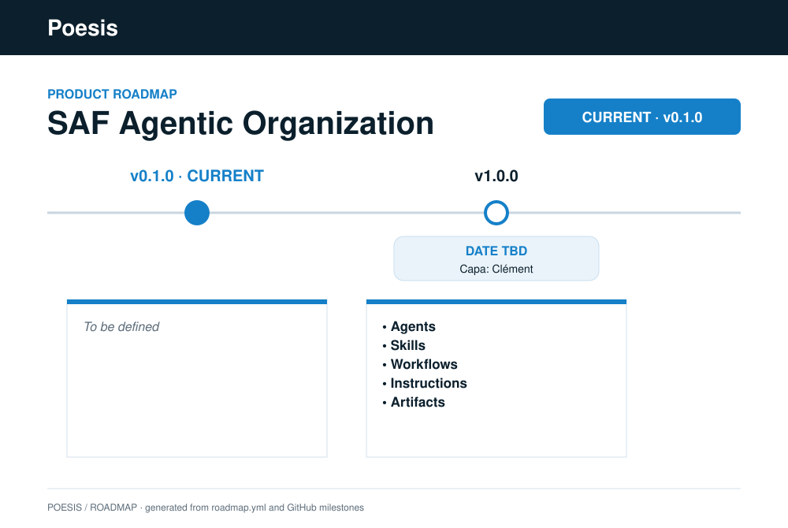

# Poesis SAFe Agentic Organization

[](https://github.com/poesis-cloud/saf-agentic-organization/actions/workflows/ci.yml)
[](https://github.com/poesis-cloud/saf-agentic-organization/releases/latest)
[](LICENSE)

> **SAFe-shaped agentic organization for GitHub Copilot / VS Code and portable agent hosts** —
> multi-agent orchestration (portfolio/program/iteration orchestrators), a framework-owned
> specialist bench, skills, instructions, workflows, artifact schemas, and deterministic model routing.
> Open-source developer tooling from [Poesis Cloud](https://poesis.cloud).

---

> **Note — v0.1:** This repository root is the **host-agnostic source** of the framework. Agents,
> skills, workflows, and configuration are its direct children, but the installable artifact is the
> **rendered host bundle** produced from [`builds/`](builds/) — see [Installing](#installing).

---

## The SAF solution

This repository is one of the three products of the Systemic Agentic Framework (SAF):

| Product | Repository | Role |
|---|---|---|
| Agentic Harness | [`saf-agentic-harness`](https://github.com/poesis-cloud/saf-agentic-harness) | the deterministic execution engine — methodology- and host-agnostic |
| **SAFe Agentic Organization** | **this repository** | the SAFe-shaped framework application the harness executes |
| Agentic Workspace | [`saf-agentic-workspace`](https://github.com/poesis-cloud/saf-agentic-workspace) | the shared data plane the harness checks and commits into |

The harness resolves this framework through `FRAMEWORK_DIR` and the workspace through
`FRAMEWORK_WORKSPACE_DIR` — the three products stay decoupled through environment-anchored paths,
not through a shared tree.


## Overview

The Poesis SAFe Agentic Organization brings SAFe-shaped multi-agent orchestration into
agent execution environments that support custom agents and skills. It includes:

- **Orchestrators**: `@value-management-officer`, `@release-train-engineer`, `@scrum-master`
- **Specialist bench**: framework-owned author, architecture, development, QA, security, operator, docs, and UX agents
- **Skills**: SAFe ceremony, practice, authoring, and orchestration playbooks loaded on demand
- **Agent-adapted ceremonies**: ART Sync, System Demo, Team Sync, Iteration Retrospective, Inspect & Adapt, PI Planning, Iteration Planning/Review (plus portfolio sync/review, Strategic Investment Planning, and Feature/Story refinement)
- **Model routing**: deterministic LLM tier + capability-score routing — no random model selection
- **Portable harness**: deterministic artifact, gate-packet, and runtime-trace checks independent of VS Code hooks —
  methodology- and host-agnostic, so the same familiar agentic work method follows you from host to host as you
  move between environments (shipped separately as [`saf-agentic-harness`](https://github.com/poesis-cloud/saf-agentic-harness))

## Usage model

This is how a human talks to the organization. Orchestrators are instructed from this
section; workflow `description` fields restate each catalog's purpose and mains.
Catalog rows implement SAFe; they are not themselves usage principles.

### Principles

1. **SAFe activity purpose constrains usecases.** A human concern is valid here only
   when it matches an existing catalog purpose at this layer. Orchestrators map
   speech onto that purpose; they do not invent ceremonies.
2. **Any concern, any form.** The human states a concern. They do not classify it,
   name a ceremony, or pick an act. The orchestrator maps it to one workflow, or
   hands the human the other-layer orchestrator to invoke.
3. **IT concerns stay inside SAFe grain.** Impact, bug, spike, debt, quality gap,
   constraint, decision — each maps onto an existing activity at Epic, Feature, or
   Story grain. Do not add parallel IT rituals.
4. **Workflows are challenge loops.** Specialists draft, challenge, and rewrite
   until challengers agree enough. Inner reviews are not the human loop.
5. **Human gate.** Each workflow delivers its mains to the human. The human reviews
   those artifacts and accepts, concerns, or rejects them. Challenge packets are
   evidence, not the thing the human is asked to score.

### 1. One layer, one grain

The human speaks to one layer orchestrator. That hat writes (new or thickens) work
items of **that layer's grain**, inside the matching SAFe activity:

| Hat | Grain |
|---|---|
| `@value-management-officer` | Epic (business or enabler, judged in-workflow) |
| `@release-train-engineer` | Feature (business or enabler, judged in-workflow) |
| `@scrum-master` | Story (business or enabler, judged in-workflow) |

The user does not pick business vs enabler. Sibling mains of the owning activity
are in-workflow writes. Wrong grain is a handoff: tell the human which
orchestrator to invoke. Do not mint a thinner item to absorb a thicker intent.

### 2. Workflows are challenge protocols

A workflow is how agents **exchange, collaborate, and challenge** while delivering
mains. The loop is draft → challenge → owner rewrite, repeated until agreement is
enough to present mains at the human gate.

| Class | Role | Challenged? | Human-gated? |
|---|---|---|---|
| **Main** | The work item or decision the activity exists to produce | Yes, before owner commit | **Yes** |
| **Challenge / mediation** | Required because 1 step = 1 artifact (reviews, minutes, risks, kanban/manifests) | **No** | **No** |

Owner rewrite absorbs challenge findings. Challengers write no owner content.

### 3. Map or hand off

The orchestrator does not require a speech-act label. It:

1. Reads the concern.
2. Loads the one workflow whose **purpose** matches, or tells the human to invoke
   another layer's orchestrator.
3. Lets that workflow loop until challengers agree enough.
4. Returns the **mains** to the human gate and waits.

Humans need not name the ceremony. Purpose still constrains the usecase. The
harness `resolve-step` walks catalog order; empty preconditions pass. Out-of-scope
sibling mains get explicit-none / no-change — never a silent skip, never an
invented sibling, never a redraft of an untouched item.

### 4. Per-workflow purpose

| Workflow | Purpose | Mains presented at the human gate |
|---|---|---|
| `epic-lean-business-case` | Write a portfolio bet | `epic`, `lean-business-case`, `epic-enabler` |
| `architectural-vision` | Portfolio runway + NFR backbone | `architecture-vision` |
| `strategic-investment-planning` | Allocate / guardrail ART funding | `budget-allocation` |
| `strategic-portfolio-review` | Keep / pivot / stop / re-rank | themes, vision, roadmap, `architecture-vision` |
| `portfolio-sync` | Portfolio snapshot | mediation record only |
| `feature-derivation` | Split an approved Epic into ART Features | `feature`, `feature-enabler` |
| `feature-backlog-refinement` | Write a PI-ready Feature | `feature`, `feature-enabler` |
| `architectural-runway-extension` | Extend ART runway (product NFR register before ADR) | `nfr-list`, `adr`, `architecture-runway` |
| `pi-planning` | ART PI commit | confirm vision/roadmap/feature/runway; write `objectives` |
| `art-sync` | Mid-PI impediments | mediation record only |
| `system-demo` | Inspect the increment; demo gate | mediation / gate record |
| `inspect-and-adapt` | PI improve | `pain-point` (mediation). A later Feature is a later Feature, not I&A |
| `release-on-demand` | Ship an accepted increment | `release-on-demand` |
| `team-backlog-refinement` | Write a ready-enough Story (including Feature→Story split) | `story`, `story-enabler` |
| `iteration-planning` | Commit the iteration | `team-manifest`, `plan` |
| `pair-programming` | Implement an already-OK Story | `code-change` |
| `verification` | Is this Story done | `qa-signoff` (challenge of Story/code-change) |
| `team-sync` / `iteration-review` / `iteration-retrospective` | Daily I&A / increment inspect / team improve | mediation records |

An impediment discovered in sync/demo that is really a Feature is a **later
Feature**, not a new workflow.

### 5. NFR model (catalog, not a usage principle)

SAFe NFRs are enduring system qualities that constrain backlogs. This organization
encodes that as a **product register** plus traces — not as Feature AC. There is
no separate relation artifact: the bind lives on existing mains.

| Artifact | Owns | Operated in | Does not own |
|---|---|---|---|
| `architecture-vision` | Cross-product NFR **backbone** | `architectural-vision` draft | Measurable product NFRs |
| `products/<product-slug>/nfr-list.md` | Canonical product NFRs | `architectural-runway-extension` / `author-nfrs` | Feature AC, Stories, ADRs |
| Feature / Feature-enabler | Which NFRs **apply** (optional tightening) | `feature-backlog-refinement` draft + owner rewrite | The canonical set |
| Story / Story-enabler | Inherit parent Feature applicability; **verify** | `team-backlog-refinement` draft + owner rewrite | The canonical set |
| ADR | Design that realizes NFRs | `architectural-runway-extension` / `author-adr` | The NFR register |
| `architecture-runway` | Enabler work that paves NFRs / ADRs | `architectural-runway-extension` rewrite | The NFR text |
| `architecture-review` / `security-review` | Missed or invented applicability | Feature and Story refinement challenges | The register or the work item |

Epic / Epic-enabler record **portfolio backbone implications** (EA hat), not product NFR ids.
`feature-derivation` mints Feature identity only; NFR traces stay deferred until Feature
refinement. A missing NFR discovered in refinement is a runway handoff, not Feature AC.

### 6. Splitting vs refinement

SAFe names the **work-item hierarchy** (Epic → Feature → Story) and the act of
**splitting**. It does not name a Feature-to-Story derivation ceremony.

| Split | SAFe concept | This catalog |
|---|---|---|
| Epic → Feature | Portfolio Epics split into Features on the ART backlog | `feature-derivation`, then `feature-backlog-refinement` |
| Feature → Story | Teams split Features into Stories on the Team backlog | `team-backlog-refinement` only — no `story-derivation` |

Derivation **mints** the thinner grain from an approved parent. Refinement **shapes**
that grain (AC, WSJF, NFR traces, challenges) until it is ready.

Do **not** fold Epic→Feature minting into Feature refinement. That split is
**cross-layer**: the parent is a portfolio Epic (VMO grain); Feature refinement's
hat is ART and already refuses Epic grain. Merging would either accept Epic-sized
intent inside a PI-ready Feature workflow, or silently mint Features inside a
challenge loop built for shaped items. Derivation has no challenges because the
minted files are stubs; they enter refinement next. Feature→Story stays inside
Team grain — the parent Feature already exists on the ART — so mint+shape can
share `team-backlog-refinement`. Do not invent a Story-derivation workflow.

## Layout

The framework is host-agnostic source; each host's manifest lives beside its renderer under
[`builds/`](builds/) (for GitHub Copilot, `builds/github-copilot/plugin.json`):

- [`agents/`](agents/) — the orchestrators and the specialist bench (`<name>.agent.md`)
- [`skills/`](skills/) — SAFe ceremony, practice, authoring, and orchestration playbooks (`<name>.skill.md`)
- [`instructions/`](instructions/) — step instructions, grouped by the actor that runs the step (`<actor>/<name>.instructions.md`); shared multi-actor refs live under `instructions/shared/`
- [`workflows/`](workflows/) — SAFe ceremony and practice catalogs by Essential layer (`portfolio/`, `program/`, `team/`)
- [`conf/`](conf/) — remaining harness configuration: `model-profiles`, `access-control-list`, `workspace`
- [`templates/`](templates/) — artifact Markdown templates, organized per layer and actor
- [`artifacts/`](artifacts/) — artifact JSON Schemas, grouped by the actor that produces the kind (`<actor>/<kind>.artifact.schema.json`)
- [`builds/`](builds/) — host bundle renderers (currently `github-copilot/`)

## Installing

Two steps, in this order — the bundle must exist before the harness can register its hooks into it.

```bash
# 1. Render the host bundle (this repository, host-agnostic source -> installable artifact)
BUNDLE=/tmp/github-copilot-bundle
python3 builds/github-copilot/render_bundle.py . "$BUNDLE"

# 2. Register the harness hooks (from the harness repository)
make install-hooks FRAMEWORK_DIR=/abs/path/to/saf-agentic-organization BUNDLE_DIR="$BUNDLE"
```

Step 1 injects each agent's `tools:` frontmatter and writes the host manifest. Step 2 renders the
workspace hook file, the orchestrators' session-started hook, and the VS Code settings that enable
hooks at all; it refuses rather than guessing if `BUNDLE_DIR` is omitted. Then install `$BUNDLE`
as the GitHub Copilot customization plugin — or install the published release asset, which is that
same bundle.

Everything step 2 writes is generated and git-ignored: it carries machine-specific absolute paths
and must never be committed.

## Deterministic Harness

The framework's deterministic checks live in the sibling
[`saf-agentic-harness`](https://github.com/poesis-cloud/saf-agentic-harness) repository and run through its
stable entrypoint `harness.py`. They are host-neutral: a CI job, shell wrapper, VS Code hook, or
another agent runtime can call the same CLI. Point the harness at this repository with
`FRAMEWORK_DIR`.

Four commands (the global options `--portfolio-root`, `--strict`, `--json` come **before** the command):

```bash
# STATE — validate Epic/Feature/Story artifacts (FSM, linkage, schema, gates, derived fields)
python3 ../saf-agentic-harness/harness.py --portfolio-root /path/to/portfolio \
  check-artifact --unit-id sie-observability-foundation

# DRIVE — resolve the next orchestration action (dispatch | halt | done)
python3 ../saf-agentic-harness/harness.py \
  orchestrate --workflow value-management-officer --unit sie-observability-foundation

# CONDITIONS — evaluate one step's conditions and append the session ledger line
python3 ../saf-agentic-harness/harness.py \
  check-step --orchestration value-management-officer --step capture-epic \
  --unit-id sie-observability-foundation --session abc123

# HOOK — funnel a host lifecycle event (JSON on stdin) through the harness
cat event.json | python3 ../saf-agentic-harness/harness.py hook --event preToolUse
```

The harness never writes artifacts — it reports the value/edge; the orchestrator commits.

### Load contract

Point `FRAMEWORK_DIR` at this checkout. Layout keys live in [`.env`](.env) (`FRAMEWORK_*_DIR`);
process environment overrides the file. Workflows live at [workflows/](workflows/). The sibling
[`saf-agentic-harness`](https://github.com/poesis-cloud/saf-agentic-harness) `ConfigLoader` must
load layout, ACL, model-profiles, workspace, and the workflow catalog without
`ConfigurationError`. Workflow `skills` / `instructions` slugs are filename stems under
`skills/` and `instructions/`. Workflow `artifact` slugs are stems of
`artifacts/<slug>.artifact.schema.json`.

### Verify this organization

```bash
# sibling checkout: ../saf-agentic-harness  (override with SAF_HARNESS_SRC)
python3 -m pip install -r requirements-dev.txt
make verify
```

`make verify` runs unit coherence (slug resolve, ceremony pairs, ACL, required-reading,
plugin 1:1) plus functional live-load (`start-session` / `resolve-step` /
`check-step-authorization` on one portfolio, program, and team workflow). Coverage on
organization Python (`tests/loaders.py` + `render_bundle.py`) must be ≥95%.

The harness constitution itself is verified separately:
`make -C ../saf-agentic-harness verify`.

---

## Contributing

See [CONTRIBUTING.md](CONTRIBUTING.md). All contributions are accepted under Apache-2.0.
This project uses the [Developer Certificate of Origin (DCO)](https://developercertificate.org/).

---

## License

Apache License, Version 2.0. See [LICENSE](LICENSE).

Copyright 2026 Poesis Cloud and contributors.

<!-- roadmap:start -->
## Roadmap



<!-- roadmap:end -->
