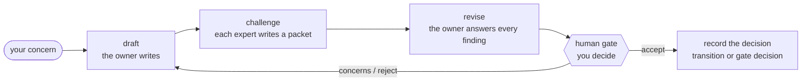
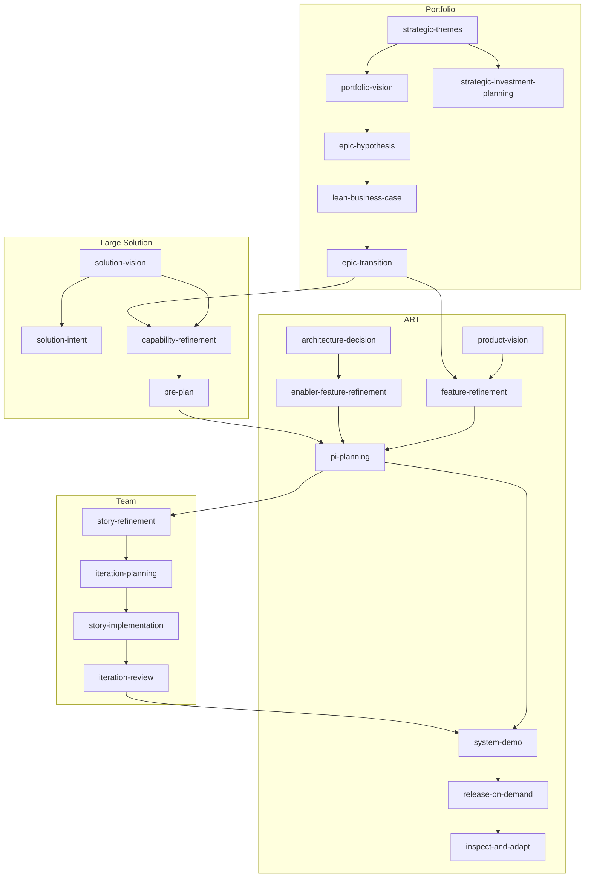

<!-- Copyright 2026 Poesis Cloud and contributors. SPDX-License-Identifier: Apache-2.0 -->

# Usage model

How a human works with the organization. The reference tables (roster, workflows, panels,
artifact kinds) are in [catalog.md](catalog.md); how SAFe maps onto it is in
[safe-conformance.md](safe-conformance.md).

## The idea in one minute

You talk to **one orchestrator**, the one of your SAFe layer. You state a concern in your own
words. The orchestrator maps it to **one workflow**, and the workflow produces **one main
artifact**: an Epic, a Feature, a PI plan, a release plan, and so on.

Before that artifact reaches you, it goes through a **challenge loop**:



- The **owner** is a SAFe role: Epic Owner, Product Manager, System Architect, Product Owner…
- The **experts** are real IT jobs: Security Expert, Site Reliability Engineer, Data Protection
  Officer, Financial Controller, UX Designer… Each one reads the draft through its own lens and
  writes findings. An expert never edits the artifact.
- The owner must **answer every finding**: accepted, rejected with a reason, or deferred to a
  named place. The answers are kept in the artifact's `challengeLedger`.
- **You decide.** The orchestrator shows you the artifact, what the experts found and what the
  owner answered, and asks one question. Nothing is approved, moved or released without your
  decision.

## Who you talk to

| You care about | Talk to | It writes, through its workflows |
|---|---|---|
| Strategy, budgets, Epics | `value-management-officer` (Portfolio) | Strategic Themes, Portfolio Vision, Lean Budgets, Epics, Lean Business Cases, Portfolio Roadmap, Architecture Vision |
| A large solution built by several ARTs and suppliers | `solution-train-engineer` (Large Solution) | Solution Vision, Solution Intent, Capabilities, Solution Roadmap, supplier agreements, Solution Train PI plan |
| A product, its Features, the PI, releases | `release-train-engineer` (ART) | Product Vision, PI Roadmap, Features, architecture decisions, NFRs, the delivery pipeline map, PI Objectives, releases |
| Stories, iterations, code | `scrum-master` (Team) | Team charter, Stories, iteration plans, code changes |

You never have to name a workflow. If your concern belongs to another layer, the orchestrator
tells you which one to talk to; it does not squeeze an Epic into a Story or the reverse.

You can start at any layer. Essential SAFe needs only the ART and Team orchestrators; add the
Large Solution orchestrator when several ARTs build one solution; add the Portfolio orchestrator
when you fund value streams and steer Epics.

## A first run

Select `release-train-engineer` and write, for example:

```text
We need customers to be able to export their invoices as PDF.
```

1. **Proposal.** The orchestrator answers that this is a Feature, proposes the workflow
   `feature-refinement`, the ART and a slug for the Feature, and waits for your yes.
2. **Draft.** The Product Manager writes the Feature: description, benefit hypothesis,
   acceptance criteria, WSJF.
3. **Challenge.** Six experts each write one packet: System Architect, Software Engineer, Quality
   Engineer, Security Expert, UX Designer, Data Protection Officer. An expert whose lens does not
   apply says so in one line.
4. **Revise.** The Product Manager changes the Feature where the findings are right and answers
   each one.
5. **Gate.** The orchestrator shows you the Feature, the verdict of each expert, and the findings
   the Product Manager rejected or deferred, with both positions. It asks: is this Feature ready
   for PI Planning?
6. **Your decision.**
   - *Accept:* start a new session and say so. The workflow `feature-transition` records the
     move to `ready` and re-renders the ART Kanban.
   - *Concerns or reject:* start a new session and state them. `feature-refinement` runs again
     on the same Feature, with your concerns as its subject.

One orchestrator session runs one workflow. After each gate the orchestrator names the workflow
that comes next and asks you to start a new session for it.

## Four kinds of workflow

| Kind | Steps | What reaches you |
|---|---|---|
| **Loop** (32 workflows) | draft → one challenge per expert → revise | a main artifact with its challenge ledger |
| **Transition** (4) | the owner records your decision as one state change → the orchestrator re-renders the Kanban | the item in its new state |
| **Event** (10) | the orchestrator records the SAFe event (and re-renders the Kanban for a sync) | the record: decisions, actions, impediments |
| **Gate decision** (4) | the orchestrator records your decision on a vision, roadmap, budget, plan… | the decision record |

Every backlog item (Epic, Capability, Feature, Story) moves on its Kanban only through its
transition workflow, written by its owner. Every other main artifact is accepted through a gate
decision record. Either way your decision becomes committed evidence.

## From strategy to code

The workflows chain along the SAFe flow. Each arrow is a human gate.



Typical paths:

- **A new initiative:** `epic-hypothesis` → `epic-transition` (to analyzing) →
  `lean-business-case` → `epic-transition` (go: ready) → `feature-refinement` per Feature →
  `pi-planning` → `story-refinement` per Story → `iteration-planning` → `story-implementation`
  → `system-demo` → `release-on-demand` → `epic-mvp-evaluation` (persevere, pivot or stop).
- **A Feature from the ART's own context:** `feature-refinement` → `feature-transition` →
  `pi-planning`. No Epic is needed.
- **A technical concern:** `architecture-decision` for a design choice, `nfr-refinement` for a
  system quality, `enabler-feature-refinement` for runway or technical debt at Feature size, a
  Story of type enabler (a spike is an exploration enabler) at team size.
- **A bug:** a Story (`story-refinement`), or a Feature when it does not fit an iteration.

## What the harness enforces

These rules are conditions checked by the harness on committed state, not advice in a prompt:

| Rule | Where |
|---|---|
| A challenge packet targets the artifact drafted in the same run | every challenge step |
| The owner revises the artifact it drafted and answers every packet of the run | every revise step |
| No acceptance without challenge: a gate decision that accepts needs at least one packet on the artifact | the four gate-decision workflows |
| A backlog item cannot leave refinement before it was challenged | the four transition workflows |
| An Epic becomes ready only with a Lean Business Case recommending go | `epic-transition` |
| A Lean Business Case names an Epic under analysis; an MVP evaluation needs an implementing Epic | `lean-business-case`, `epic-mvp-evaluation` |
| A Capability, Feature or Story splits only from an approved parent (or has none) | the refinement workflows |
| PI Planning needs a ready Feature (or Capability); Iteration Planning and implementation need a ready Story; a release needs a built Feature | their first step |
| Each agent writes only the artifact kinds its steps deliver | the access control list |

When a rule refuses a step, the orchestrator tells you which state is missing and which workflow
produces it.

## Why it stays small

Each step runs in its own session with a small, fixed context: the step contract, the pattern of
the step, the workflow brief (three short instructions) and one craft skill. The worker reads the
one artifact it works on, from a template. Experts do not read each other's packets; only the
owner reads them all. The orchestrator carries its four duties and its catalog, and relays paths,
not content.

## What the organization does not do

- It does not decide for you, and it does not record a decision you did not state.
- It does not merge code. `story-implementation` works on a branch and records the change; a
  human reviews and merges the pull request.
- It does not sign contracts or commit budgets: a supplier agreement and Lean Budgets are working
  artifacts for the humans who hold that authority.
- It does not give binding legal, privacy or compliance opinions: the experts flag issues for
  your accountable officers.
